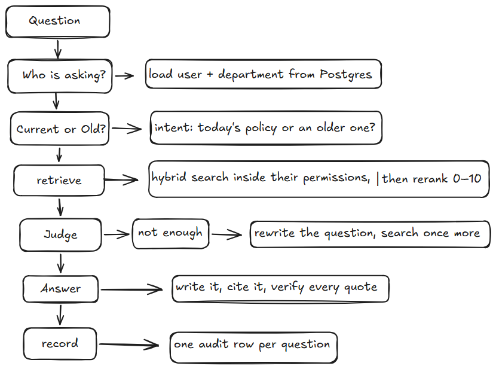

# How I Built Aegis: A Zero-Trust RAG Pipeline That Can't Lie

While climbing thorugh the mountain of AI engineering you need to face the one of the most important peak and that is RAG and personaly when i built this RAG pipiline/systeam then i understood the real importance of it becuase its solve the very cruicual problem in AI and that is very obvius so i chose the scenario and the use case to build the project around the RAG and that is the enterprise RAG assitant and more about it as follows:

A company with departments: HR, finance, engineering, support. Each owns its own documents. Leave policy
and compensation belong to HR, reimbursement and discount approvals to finance, error codes and the
security policy to engineering, refunds and shipping and warranty to support.
An employee should be able to ask a question in plain language instead of hunting through a shared drive. And
the part that makes this a secure assistant:

NOT EVERYONE MAY READ EVERYTHING :

Someone in HR must not be able to pull engineering's restricted documents, and a guest from outside
the company must see almost nothing. In most RAG demos this is skipped. Here it is the centre of the
design, which is why access control is applied in SQL before the search runs rather than filtered out
afterwards.

## Why "Tutorial RAG" Breaks in Production

### The Real-World Problem
That every RAG tutorial ends happy with toy documents, but a real company has permissions, edited policies, and auditors.

the flow of the RAG tutorials:
load → chunk → embed → top-k → answer

And this are the problems that the tutorial rag systeam / the broken systeam faces and:
- Everyone sees everything (No RBAC)
- A company edits documents (tutorial RAG appends chunks, so old and new versions of a policy both answer questions.)
- Vector search alone misses exact matches (policy IDs, section titles, and exact phrases.) 
- The model makes things up and nobody can check (with no citations, no verification, and no audit trail) 
- And lot of others as well but its not possible to make the the fully robust RAG systeam for anyone becuase you will only get the fix when you will get introduce to a real time issues/problem when your RAG systeam will break in the real time

That every RAG tutorial ends happy with toy documents, but a real company has permissions, edited policies, and auditors.
As an example supose you built the broken rag systeam for the enterprise and as we all know in the enterprise/corporate we have the lot of indivdual depratment and most of the time every department is confidential to others means if you have the broken RAG systeam then the person from the engineering department can be able to acsses the confidental docuemnts from the HR department and things like these exactly no one wants and this is the only one example there are plenty when you have the broken RAG systeam some are the example i already mentioned above and as an AI engineer its your respnosiblity always to identify such scenraios and fix them 

###  How Aegis Engineers the Fix
That Aegis replaces the free-floating demo with a fixed seven-step pipeline, and each later blog section is one checkpoint.

These are the pipeline steps in the order that built : identify → intent → retrieve → judge → correct → answer → record
Every step has a measurable exit condition (permissions enforced, chunks sufficient, quotes verified).
Failures are honest: if retrieval can't find enough, it says "I can't answer" instead of guessing.

###  The pipeline diagram
 

## System Architecture & Strict Data Contracts

## Content-Addressable Ingestion & Two-Level Splitting

## Security Before Retrieval: SQL RBAC & The "Time-Travel" Intent Switch

## Single-Trip Hybrid Search, Reranking & The Corrective Loop

## Grounded Generation & Deterministic Quote Verification

## Radical Auditability: The Live Execution Trace

## What I Learned Building a Zero-Trust RAG Pipeline